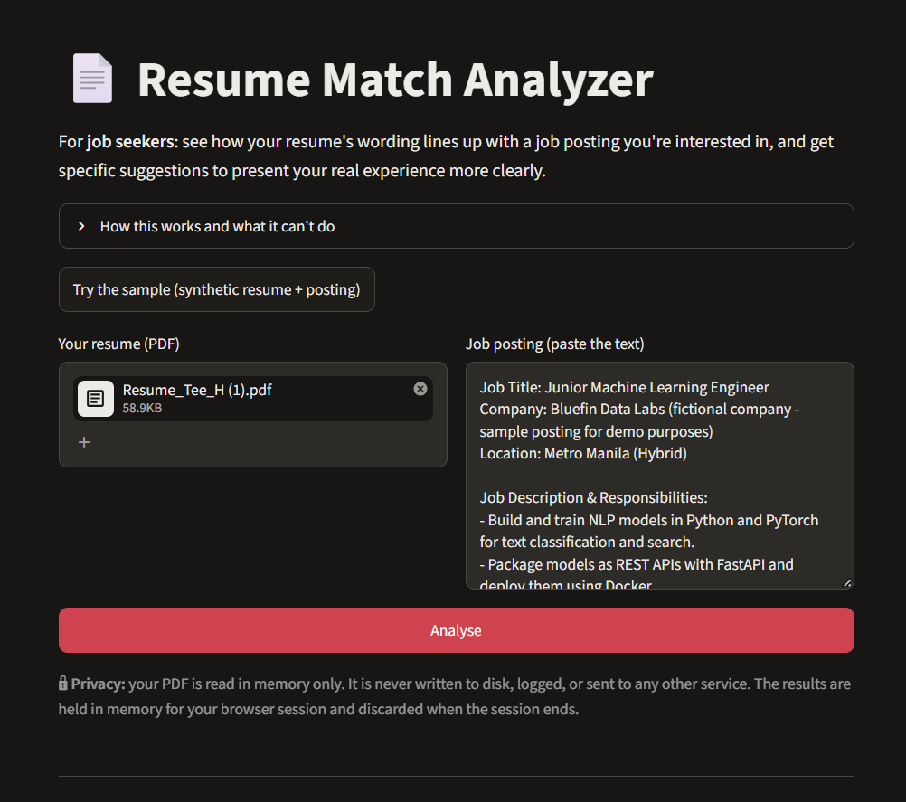

# Resume Match Analyzer

A tool for **job seekers**: upload your resume, paste a job posting, and see how
closely your resume's wording matches it, with specific suggestions for
presenting your real experience more clearly.

Runs locally (see [Running locally](#running-locally-windows-cmd)). No upload
needed to try it: click **"Try the sample"** for a synthetic resume and posting.

<!-- Add a screenshot: save it as docs/screenshot.png, then replace this comment with:
 -->

## What it does

You give it two things: your resume (PDF) and the text of one job posting you're
considering. It gives back:

- a **match estimate** (0-100) with a breakdown of where it comes from
- the posting's skills that **appear** in your resume, and the ones that **don't**,
  ordered by how often the posting mentions them
- **suggestions**, phrased as options ("consider naming Docker *if you have
  experience with it*"), never as judgements

The output is about how your resume *reads* against one posting. It says nothing
about you as a candidate.

## Why this is candidate-facing, not employer-facing

The techniques here (keyword extraction, sentence embeddings, similarity scoring)
are the same ones used in automated resume screening. The difference is who
receives the output, and that difference is the whole design.

**Automated screening that decides about people is high-stakes and has a track
record.** The standard example is Amazon's experimental recruiting model,
reported by Reuters in 2018 and scrapped. It was trained on a decade of past
hiring, learned to penalise resumes containing the word "women's" (as in "women's
chess club captain"), and downgraded graduates of two all-women's colleges. The
model did what it was built to do: it reproduced the patterns in its training
data, and those patterns were biased.

This project has the same structural weakness. Its weights are judgement calls,
its skill list is hand-picked, and its embeddings come from a model trained on web
text with whatever associations that text contains. None of it has been validated
against hiring outcomes (see [Limitations](#limitations)). For a tool that
**filters** applicants, those flaws turn into wrongly rejected people who never
find out why. That is an unacceptable failure mode for something this
unvalidated.

**Turning it around changes what an error costs.** When the job seeker sees the
output:

- **A wrong score is visible and contestable.** The person it describes can read
  the breakdown, see that "Data Science x4" was counted as missing, and decide
  whether that's fair. Nobody is silently screened out.
- **The person with the most context makes the decision.** They know whether they
  actually used Docker. The tool can't, so it asks rather than assumes.
- **The advice favours honesty.** The tool only ever suggests *naming* experience
  the person has. It never suggests adding skills they lack, and the suggestion
  text says so explicitly. Its job is to help real experience survive keyword
  filters, not to help anyone game them.
- **It redistributes an advantage.** Recruiters already have screening software.
  Applicants mostly guess. A tool that shows applicants roughly what keyword
  filtering sees narrows that gap a little.

The same scoring code would be irresponsible as a filter and is reasonable as
feedback. The application matters more than the algorithm.

## How the scoring works

| Component        | Weight | Method |
|------------------|-------:|--------|
| Skills match     | 40%    | Keyword matching against a ~240-skill curated vocabulary |
| Experience match | 30%    | Embedding similarity: resume Experience/Projects vs posting responsibilities |
| Education match  | 15%    | Embedding similarity: field of study vs posting's degree requirement |
| Overall semantic | 15%    | Embedding similarity: whole resume vs whole posting |

**The weights are judgement calls.** They were not learned from data, and they
have not been validated against hiring outcomes, because there is no dataset to
validate them against. The reasoning for each one is in
[docs/scoring_design.md](docs/scoring_design.md): skills weighs most because it
produces the most actionable advice and is closest to real ATS behaviour;
education weighs least because degree filtering is exclusionary and short
education lines carry little signal. You could reasonably argue for 50/25/10/15.
Nothing here proves 40/30/15/15 is better.

**Why hybrid.** Keyword matching handles hard skills: it's explicit, it's what
many ATS filters actually check, and it yields concrete "matched / missing" lists
the advice is built from. Embeddings (`all-mpnet-base-v2`) handle semantic fit,
crediting related work described in different words. Each covers the other's
blind spot.

**Missing sections don't score zero.** If the parser can't find an Education
heading, that component's weight is shared among the others and the result says
so. "We couldn't find it" must not silently become "you scored 0".

### Calibration: the similarity floor

Cosine similarity between two unrelated English texts is not near zero, because
they share ordinary words and grammar. To find the floor, a tech resume was
scored against two postings from unrelated fields (nursing and accounting):

| Component  | Nursing | Accounting | Floor used |
|------------|--------:|-----------:|-----------:|
| Experience | 0.043   | 0.085      | **0.085**  |
| Education  | 0.228   | 0.275      | **0.275**  |
| Whole resume | 0.123 | 0.203      | **0.203**  |

Without rescaling, the unrelated accounting posting would have displayed as 20%,
and every real posting would have been squeezed into 37-52%. Each component is
rescaled so its floor maps to 0 and a measured ceiling maps to 100. The ceiling
comes from a synthetic resume written to paraphrase the posting: experience 0.75,
whole resume 0.72, education 0.45.

To avoid circular testing, the calibration was then checked against a third
unrelated posting (elementary teacher) that was **not** used to set the floor.

## Results

Pairs 1-5 use the author's own resume (not included in the repo) against four real
Kalibrr postings and one held-out synthetic posting. Pair 6 uses the bundled
synthetic sample.

| # | Posting | Expectation | Score | Skills | Exp | Edu | Overall |
|---|---------|-------------|------:|-------:|----:|----:|--------:|
| 1 | Cloud Data Scientist / AI-ML Engineer | would apply | **54.0** | 21.1 | 72.7 | 96.9 | 61.5 |
| 2 | MLOps Specialist (2+ yrs) | would apply | **40.0** | 18.8 | 57.8 | n/a | 61.1 |
| 3 | Senior Data Scientist | should be lower | **45.1** | 46.7 | 38.3 | n/a | 54.2 |
| 4 | Data Engineer (Databricks) | adjacent field | **19.1** | 18.2 | 13.8 | n/a | 32.0 |
| 5 | Grade 4 Teacher *(unrelated, held out)* | near zero | **3.8** | n/a | 7.7 | 0.0 | 0.0 |
| 6 | Sample resume: **before → after advice** | should rise | **63.4 → 81.0** | 40 → 75 | 73.4 → 80.5 | 100 → 100 | 69.4 → 79.2 |

**Pair 6: following the advice raised the score by 17.6 points.** The "after"
resume adds no new experience. It names things the "before" resume already
described: "packaged it in a container" became "packaged it with Docker", and
"a cloud virtual machine" became "an AWS EC2 virtual machine"
([script](scripts/make_sample_resume.py)). Most of the gain is in skills match
(40 → 75). That is the intended effect, and it also exposes the tool's main
weakness: keyword matching rewards wording, so a resume that only *names* the
right tools scores the same as one backed by real depth.

**What the results get wrong.** The unrelated posting scores clearly lowest (15
points below the next). But the **senior role (45.1) outscores the MLOps role
(40.0)**, against expectation. The Senior Data Scientist posting lists techniques
the resume genuinely covers (regression, decision trees, neural networks, SQL,
statistics), and embeddings measure topic overlap, not seniority. Rather than add
an unvalidated seniority penalty, the app shows a note whenever a posting has a
senior title or asks for N+ years.

## Limitations

- **No ground truth: accuracy is unmeasured.** There is no dataset of "correct"
  resume-posting match scores. The numbers above show the scores *rank*
  sensibly on a handful of examples, which is a much weaker claim than being
  accurate. Nothing here is validated.
- **The weights are unvalidated** judgement calls (see above).
- **Semantic similarity measures topic overlap, not competence.** A
  keyword-stuffed resume scores well. "Used Docker once" and "ran Docker in
  production for three years" look the same. Seniority and years of experience
  are not measured.
- **PDF parsing breaks on designed layouts.** The parser uses **pdfplumber**.
  `pypdf` was tested first and rejected: on a real resume it returned text in
  internal drawing order, with the Skills list under the Education heading and
  dates attached to the wrong jobs. pdfplumber reads each line straight across
  the page, which **interleaved the columns of a two-column resume** ("SKILLS
  EXPERIENCE / Python, SQL Data Analyst Intern…") and found 1 of 3 sections. A
  column-gutter detector now fixes the simple two-column case. Three-column
  layouts, a full-width header above columns, tables, text boxes, and
  icons-instead-of-headings are still likely to fail.
- **Section detection is heuristic.** It recognises a fixed list of headings
  ("Work Experience", "Technical Skills", "Projects", …). Creative headings
  ("Where I've Been", "Toolbox") are missed. The app reports which sections it
  found and lowers its confidence when it finds none.
- **The skill vocabulary is hand-curated and tech-focused** (~240 skills). It
  won't transfer to nursing, accounting, law, etc.: a nursing posting yields zero
  recognised skills. It also has known false positives, e.g. a middle initial "C."
  is read as the C language.
- **Education matching compares field of study only**, after a measured bug:
  comparing whole degree lines ranked "Bachelor of Science in Nursing" above an
  "Engineering" requirement for an engineering graduate.
- **Scanned PDFs need OCR**, which the tool doesn't do. It detects them (under
  100 characters of text) and says so.
- **Small evaluation set.** Model choice and calibration were based on one real
  resume, four real postings and three synthetic ones.

## Philippine context

Job seekers in the Philippines commonly apply through JobStreet, Kalibrr and
LinkedIn, and many employers recruiting there screen applications with
applicant tracking systems or the platforms' own screening and matching
features, which often look for specific terms. Where that happens, a resume that
describes the right experience in different words can be passed over. Showing
which of a posting's terms a resume doesn't use, so the applicant can name real
experience in the posting's vocabulary, is useful in that setting. The tool
doesn't know how any particular employer or platform actually ranks applicants,
and its estimate shouldn't be read as a prediction of one.

## What I'd do next

**Collect a small labelled dataset and fit the weights instead of guessing them.**
Concretely: about 100-200 resume/posting pairs (with consent, anonymised), each
rated by two or three working recruiters on a simple scale ("would shortlist /
maybe / would not"). With that you can:

1. measure how well the current heuristic agrees with recruiters (rank
   correlation), which is the first real accuracy number this project would
   have;
2. fit the four component weights with a simple regression and see whether
   40/30/15/15 survives;
3. check whether recruiter agreement differs across groups of candidates
   *before* trusting any of it.

That's the honest route from "plausible heuristic" to "validated tool". Until
then, the scores are an estimate, and the README should keep saying so.

## Running locally (Windows CMD)

```
python -m venv .venv
.venv\Scripts\activate
pip install -r requirements.txt
streamlit run app.py --server.address localhost
```

Tests and measurement scripts (need your own files in `data/`, which is gitignored):

```
python test_skills.py          word-boundary tests for skill extraction (no files needed)
python test_parser.py          PDF extraction + section detection on your resume
python compare_models.py       MiniLM vs mpnet: timing, size, raw similarities
python test_scorer.py          full scoring breakdown against several postings
python test_advice_loop.py     does following the advice raise the score? (sample data)
```

## Privacy

The uploaded PDF is read **in memory only**: the bytes are wrapped in a `BytesIO`
and parsed directly, so no file (not even a temporary one) is written to disk.
Nothing about uploads is logged or printed, Python error details are hidden from
the browser, and Streamlit usage statistics are switched off. Results stay in
memory for your browser session only.

The bundled sample resume is **synthetic**: "Alex Rivera" is an invented person,
with a reserved `example.com` email and no phone number or address.

## Licence

MIT. See [LICENSE](LICENSE).
